# Matriz de bugs – SauceDemo

| Campo | Valor |
|-------|-------|
| Fecha | 2026-10-22 |
| Producto | https://www.saucedemo.com |
| Navegador | Chromium (Playwright 1.64.1), 1280×800 y 1920×1080 |
| Total | **21 hallazgos**: 2 bloqueantes · 7 visuales · 12 no bloqueantes |
| Evidencias | Imágenes en `documentacion/evidencias/` y medidas en `documentacion/evidencias/mediciones.json` (se regeneran con `node automatizacion/herramientas/capturar-evidencias.mjs`) |
| Relacionado | [evaluacion-de-bugs.md](evaluacion-de-bugs.md) (comparación manual vs. agente) |

## 1. Cómo se clasifica

**Categoría de bloqueo**

| Categoría | Criterio |
|-----------|----------|
| **Bloqueante** | Impide iniciar sesión o completar la compra, el flujo principal del negocio |
| **Visual** | Solo afecta la presentación (posición, imagen, contraste, alineación, íconos); la función sigue disponible |
| **No bloqueante** | Falla una función secundaria, el contenido, la navegación o el rendimiento, pero el flujo principal se puede completar |

**Severidad:** **Blocker** (impide el flujo principal) · **Major** (función importante o dato incorrecto, hay alternativa) · **Minor** (detalle, texto, estética o mejora).

**Origen:** **Producto** = defecto del sitio con cualquier usuario · **Usuario de prueba (intencional)** = fallo diseñado en `problem_user`, `performance_glitch_user`, `error_user` o `visual_user`: se documenta, no se reporta como bug del producto · **Por definir con producto** = el documento no define qué es lo correcto.

## 2. Resumen

| Categoría | Cantidad | Bugs |
|-----------|----------|------|
| **Bloqueantes** | 2 | BUG-11, BUG-14 |
| **Visuales** | 7 | BUG-04, BUG-06, BUG-08, BUG-18, BUG-19, BUG-20, BUG-21 |
| **No bloqueantes** | 12 | BUG-01, BUG-02, BUG-03, BUG-05, BUG-07, BUG-09, BUG-10, BUG-12, BUG-13, BUG-15, BUG-16, BUG-17 |

| Origen | Cantidad | Bugs |
|--------|----------|------|
| Producto o por definir | 7 | BUG-01, BUG-02, BUG-03, BUG-04, BUG-05, BUG-06, BUG-07 |
| Usuario de prueba (intencional) | 14 | BUG-08, BUG-09, BUG-10, BUG-11, BUG-12, BUG-13, BUG-14, BUG-15, BUG-16, BUG-17, BUG-18, BUG-19, BUG-20, BUG-21 |

| Severidad | Cantidad |
|-----------|----------|
| Blocker | 2 |
| Major | 8 |
| Minor | 11 |

**Conclusión clave:** ningún defecto del producto con el usuario normal (`standard_user`) bloquea el flujo principal. Los dos bloqueantes
(BUG-11, BUG-14) son fallos intencionales de `problem_user` y `error_user`. Los defectos del producto son no bloqueantes o visuales.

## 3. Matriz

| ID | Hallazgo | Categoría | Tipo | Severidad | Usuario | Origen | Requisito | Test | Evidencia | Issue | Lo encontró |
|----|----------|-----------|------|-----------|---------|--------|-----------|------|-----------|-------|-------------|
| [BUG-01](#bug-01) | Se puede iniciar el checkout con el carrito vacío | **No bloqueante** | Funcional | Major | `standard_user` | Producto | Duda 11.1 | `CHK-12` | [BUG-01](evidencias/BUG-01.png) | [#1](https://github.com/willcardenassilva/QA-Automation/issues/1) | Ambos |
| [BUG-02](#bug-02) | "Reset App State" no devuelve los botones a "Add to cart" sin recargar | **No bloqueante** | Funcional (estado de la interfaz) | Minor | `standard_user` | Producto | RF-MEN-05 | `MEN-04b` | [BUG-02](evidencias/BUG-02.png) | [#2](https://github.com/willcardenassilva/QA-Automation/issues/2) | Agente |
| [BUG-03](#bug-03) | El producto 6 se llama "Test.allTheThings() T-Shirt (Red)" y su imagen es un suéter naranja | **No bloqueante** | Contenido | Minor | Todos | Por definir con producto | RF-PRO-01 · duda 11.9 | Sin test (criterio de producto) | [BUG-03](evidencias/BUG-03.png) | [#3](https://github.com/willcardenassilva/QA-Automation/issues/3) | Persona |
| [BUG-04](#bug-04) | El mensaje de error del login tiene poco contraste | **Visual** | Visual / accesibilidad | Minor | Todos (sin sesión) | Producto | RNF-VIS-05 | `VIS-26` | [BUG-04](evidencias/BUG-04.png) | [#4](https://github.com/willcardenassilva/QA-Automation/issues/4) | Persona |
| [BUG-05](#bug-05) | Con la sesión activa, "atrás" muestra el formulario de login | **No bloqueante** | Navegación / sesión | Minor | `standard_user` | Por definir con producto | Duda 11.8 | `LOG-11` | [BUG-05](evidencias/BUG-05.png) | Sin issue (por definir) | Persona |
| [BUG-06](#bug-06) | El botón "Back Home" no está centrado | **Visual** | Visual | Minor | `standard_user` | Por definir con producto | RF-CHK-14 · duda 11.11 | `VIS-15` | [BUG-06](evidencias/BUG-06.png) | Sin issue (por confirmar) | Agente |
| [BUG-07](#bug-07) | Dynamic Catalog – Lazy Load carga cerca de 100 tarjetas con solo 21 nombres distintos | **No bloqueante** | Funcional / contenido | Minor | `standard_user` y `visual_user` | Por definir con producto | RF-DYN-01 · duda 11.7 | `DYN-01` | [BUG-07](evidencias/BUG-07.png) | Sin issue (función no documentada) | Persona |
| [BUG-08](#bug-08) | Todas las imágenes de los productos son la misma | **Visual** | Visual | Major | `problem_user` | Usuario de prueba (intencional) | RF-PRO-01 · RNF-VIS-02 | `USR-01` | [BUG-08](evidencias/BUG-08.png) | No aplica (defecto intencional) | Ambos |
| [BUG-09](#bug-09) | El orden por precio y Z–A no funciona | **No bloqueante** | Funcional | Major | `problem_user` | Usuario de prueba (intencional) | RF-PRO-03 | `USR-03` | [BUG-09](evidencias/BUG-09.png) | No aplica (defecto intencional) | Ambos |
| [BUG-10](#bug-10) | Solo 3 de 6 botones "Add to cart" funcionan | **No bloqueante** | Funcional | Major | `problem_user` | Usuario de prueba (intencional) | RF-PRO-05, RF-PRO-06 | `USR-02` | [BUG-10](evidencias/BUG-10.png) | No aplica (defecto intencional) | Ambos |
| [BUG-11](#bug-11) | El apellido se escribe en el campo del nombre y no se puede completar el checkout | **Bloqueante** | Funcional | Blocker | `problem_user` | Usuario de prueba (intencional) | RF-CHK-01, RF-CHK-05 | `USR-04`, `MAT-problem_user` (C09, C10) | [BUG-11](evidencias/BUG-11.png) | No aplica (defecto intencional) | Agente |
| [BUG-12](#bug-12) | Al ordenar aparece un aviso de error de Backtrace y no ordena | **No bloqueante** | Funcional | Major | `error_user` | Usuario de prueba (intencional) | RF-PRO-03 | `USR-03b` | [BUG-12](evidencias/BUG-12.png) | No aplica (defecto intencional) | Ambos |
| [BUG-13](#bug-13) | Solo algunos botones agregan y ninguno quita desde el listado | **No bloqueante** | Funcional | Major | `error_user` | Usuario de prueba (intencional) | RF-PRO-05, RF-PRO-06 | `USR-02b`, `USR-02c` | [BUG-13](evidencias/BUG-13.png) | No aplica (defecto intencional) | Ambos |
| [BUG-14](#bug-14) | No se puede finalizar la compra (Finish no completa) | **Bloqueante** | Funcional | Blocker | `error_user` | Usuario de prueba (intencional) | RF-CHK-13 | `USR-06`, `MAT-error_user` (C09, C10) | [BUG-14](evidencias/BUG-14.png) | No aplica (defecto intencional) | Agente |
| [BUG-15](#bug-15) | Login y carga del inventario tardan unos 5 segundos | **No bloqueante** | Rendimiento | Major | `performance_glitch_user` | Usuario de prueba (intencional) | Duda 11.4 (umbral 3 s de prueba) | `USR-05`, `MAT-performance_glitch_user` (C11) | [BUG-15](evidencias/BUG-15.png) | No aplica (defecto intencional) | Ambos |
| [BUG-16](#bug-16) | Ordenar por precio tarda unos 5 segundos | **No bloqueante** | Rendimiento | Minor | `performance_glitch_user` | Usuario de prueba (intencional) | Duda 11.4 | `USR-05b`, `MAT-performance_glitch_user` (C12) | [BUG-15](evidencias/BUG-15.png) | No aplica (defecto intencional) | Ambos |
| [BUG-17](#bug-17) | Los precios mostrados son aleatorios y cambian en cada carga | **No bloqueante** | Contenido / funcional | Major | `visual_user` | Usuario de prueba (intencional) | RF-PRO-01, RF-PRO-03 | `USR-07a`, `MAT-visual_user` (C04, C06) | [BUG-17a](evidencias/BUG-17a.png) · [BUG-17b](evidencias/BUG-17b.png) · [BUG-17c-ordenado](evidencias/BUG-17c-ordenado.png) | No aplica (defecto intencional) | Agente |
| [BUG-18](#bug-18) | La imagen del primer producto no es la correcta | **Visual** | Visual | Minor | `visual_user` | Usuario de prueba (intencional) | RNF-VIS-02 | `USR-07c`, `MAT-visual_user` (C16) | [BUG-18](evidencias/BUG-18.png) | No aplica (defecto intencional) | Ambos |
| [BUG-19](#bug-19) | El ícono del carrito está desplazado y se solapa con el selector de orden | **Visual** | Visual | Minor | `visual_user` | Usuario de prueba (intencional) | RNF-VIS-01, RNF-VIS-07 | `USR-07b`, `MAT-visual_user` (C13) | [BUG-19](evidencias/BUG-19.png) | No aplica (defecto intencional) | Ambos |
| [BUG-20](#bug-20) | El botón Checkout del carrito aparece desplazado a la esquina superior | **Visual** | Visual | Minor | `visual_user` | Usuario de prueba (intencional) | RNF-VIS-07 | `USR-07d`, `MAT-visual_user` (C14) | [BUG-20-estandar](evidencias/BUG-20-estandar.png) · [BUG-20](evidencias/BUG-20.png) | No aplica (defecto intencional) | Ambos |
| [BUG-21](#bug-21) | El ícono del menú está inclinado | **Visual** | Visual | Minor | `visual_user` | Usuario de prueba (intencional) | RNF-VIS-07 | `USR-07e`, `MAT-visual_user` (C15) | [BUG-21-estandar](evidencias/BUG-21-estandar.png) · [BUG-21-visual](evidencias/BUG-21-visual.png) | No aplica (defecto intencional) | Persona |

## 4. Fichas detalladas

### BUG-01

**Se puede iniciar el checkout con el carrito vacío**

| Categoría | Tipo | Severidad | Usuario | Origen | Lo encontró | Issue |
|-----------|------|-----------|---------|--------|-------------|-------|
| **No bloqueante** | Funcional | Major | `standard_user` | Producto | Ambos | [#1](https://github.com/willcardenassilva/QA-Automation/issues/1) |

**Requisito:** Duda 11.1 · **Test:** `CHK-12`

**Pasos para reproducir**
1. Iniciar sesión con `standard_user` (carrito en 0)
2. Pulsar el ícono del carrito
3. Pulsar **Checkout**

**Resultado esperado:** No debería permitir la compra sin productos: un aviso de carrito vacío o el botón deshabilitado (el documento no lo define, duda 11.1).

**Resultado observado:** Se abre `/checkout-step-one.html` con 0 productos en el carrito.

**Impacto:** Permite iniciar un pedido vacío. No impide comprar con productos, por eso no es bloqueante.

**Evidencia**

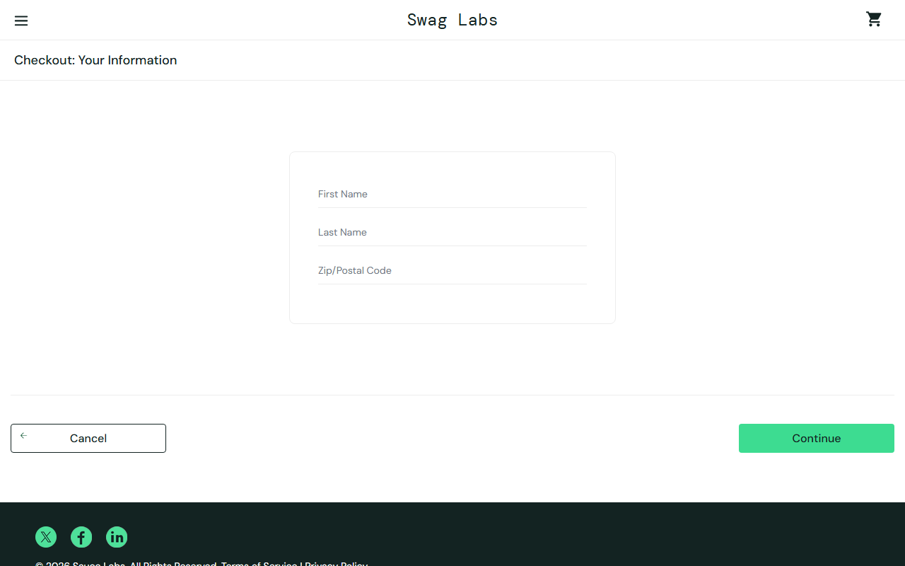

### BUG-02

**"Reset App State" no devuelve los botones a "Add to cart" sin recargar**

| Categoría | Tipo | Severidad | Usuario | Origen | Lo encontró | Issue |
|-----------|------|-----------|---------|--------|-------------|-------|
| **No bloqueante** | Funcional (estado de la interfaz) | Minor | `standard_user` | Producto | Agente | [#2](https://github.com/willcardenassilva/QA-Automation/issues/2) |

**Requisito:** RF-MEN-05 · **Test:** `MEN-04b`

**Pasos para reproducir**
1. Iniciar sesión
2. Agregar Backpack y Bike Light
3. Menú → **Reset App State**
4. Cerrar el menú y mirar el listado

**Resultado esperado:** Carrito en 0 y todos los botones en *Add to cart*.

**Resultado observado:** El contador desaparece (badge visible: 0), pero 2 botones siguen en *Remove* hasta recargar la página.

**Impacto:** La interfaz muestra productos como agregados cuando el carrito está vacío. Se corrige al recargar.

**Evidencia**

### BUG-03

**El producto 6 se llama "Test.allTheThings() T-Shirt (Red)" y su imagen es un suéter naranja**

| Categoría | Tipo | Severidad | Usuario | Origen | Lo encontró | Issue |
|-----------|------|-----------|---------|--------|-------------|-------|
| **No bloqueante** | Contenido | Minor | Todos | Por definir con producto | Persona | [#3](https://github.com/willcardenassilva/QA-Automation/issues/3) |

**Requisito:** RF-PRO-01 · duda 11.9 · **Test:** Sin test (criterio de producto)

**Pasos para reproducir**
1. Iniciar sesión
2. Observar el sexto producto del listado

**Resultado esperado:** Un nombre comercial coherente con la imagen: una camiseta (*T-Shirt*) de color rojo (*Red*).

**Resultado observado:** Nombre: `Test.allTheThings() T-Shirt (Red)` (expresión de código). Imagen `red-tatt-1200x1500-E-qp6aYf.jpg`: prenda naranja-salmón con aspecto de suéter (color medio RGB 209,131,113).

**Impacto:** Confunde al comprador sobre lo que adquiere.

**Evidencia**

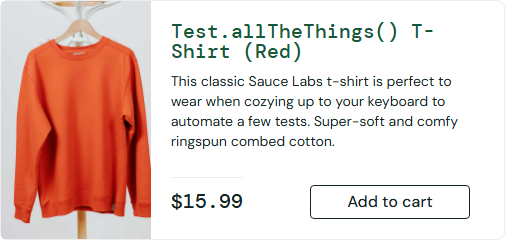

### BUG-04

**El mensaje de error del login tiene poco contraste**

| Categoría | Tipo | Severidad | Usuario | Origen | Lo encontró | Issue |
|-----------|------|-----------|---------|--------|-------------|-------|
| **Visual** | Visual / accesibilidad | Minor | Todos (sin sesión) | Producto | Persona | [#4](https://github.com/willcardenassilva/QA-Automation/issues/4) |

**Requisito:** RNF-VIS-05 · **Test:** `VIS-26`

**Pasos para reproducir**
1. Abrir https://www.saucedemo.com
2. Pulsar **Login** sin datos
3. Leer el mensaje

**Resultado esperado:** Contraste mínimo 4,5:1 (WCAG AA) y, de preferencia, cerca de 7:1; texto cómodo de leer.

**Resultado observado:** Texto rgb(255, 255, 255) de 14px sobre rgb(226, 35, 26): contraste **4.68:1**. Cumple AA por muy poco; no llega a AAA.

**Impacto:** Dificulta la lectura del motivo del error, sobre todo con poca luz o baja visión.

**Evidencia**

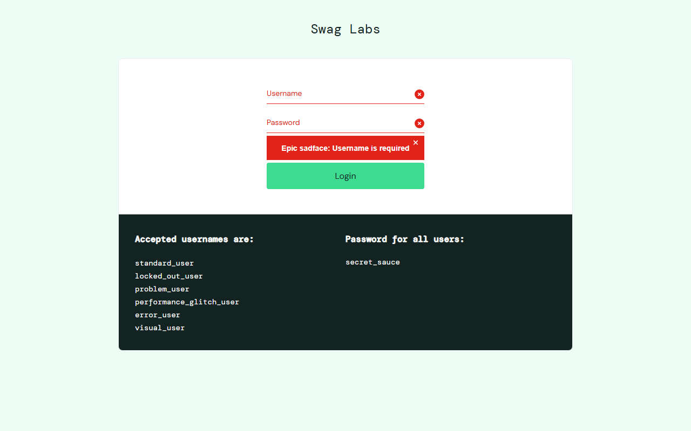

### BUG-05

**Con la sesión activa, "atrás" muestra el formulario de login**

| Categoría | Tipo | Severidad | Usuario | Origen | Lo encontró | Issue |
|-----------|------|-----------|---------|--------|-------------|-------|
| **No bloqueante** | Navegación / sesión | Minor | `standard_user` | Por definir con producto | Persona | Sin issue (por definir) |

**Requisito:** Duda 11.8 · **Test:** `LOG-11`

**Pasos para reproducir**
1. Iniciar sesión
2. Pulsar "atrás" del navegador
3. Pulsar "adelante"

**Resultado esperado:** Por definir con producto: lo razonable es no mostrar el formulario de login con una sesión abierta (o redirigir al inventario).

**Resultado observado:** Tras "atrás" se ve `https://www.saucedemo.com/` con el formulario de login visible (1) y la cookie de sesión sigue presente (True). "Adelante" vuelve al inventario.

**Impacto:** Estado inconsistente; se puede iniciar sesión con otro usuario sobre la sesión abierta.

**Evidencia**

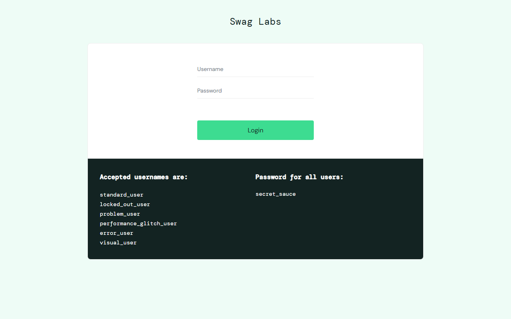

### BUG-06

**El botón "Back Home" no está centrado**

| Categoría | Tipo | Severidad | Usuario | Origen | Lo encontró | Issue |
|-----------|------|-----------|---------|--------|-------------|-------|
| **Visual** | Visual | Minor | `standard_user` | Por definir con producto | Agente | Sin issue (por confirmar) |

**Requisito:** RF-CHK-14 · duda 11.11 · **Test:** `VIS-15`

**Pasos para reproducir**
1. Completar una compra
2. Observar la pantalla "Checkout: Complete!" a 1920×1080

**Resultado esperado:** Botón centrado como en el wireframe, alineado con la imagen y el encabezado.

**Resultado observado:** Centro del botón en x=873; centro de la página y del encabezado en x=960 (-87 px).

**Impacto:** Alineación inconsistente en la pantalla de confirmación.

**Evidencia**

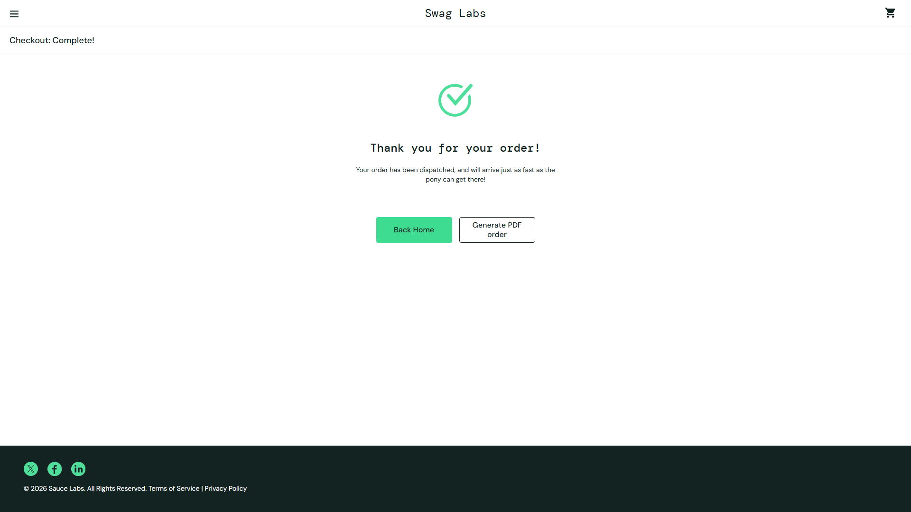

### BUG-07

**Dynamic Catalog – Lazy Load carga cerca de 100 tarjetas con solo 21 nombres distintos**

| Categoría | Tipo | Severidad | Usuario | Origen | Lo encontró | Issue |
|-----------|------|-----------|---------|--------|-------------|-------|
| **No bloqueante** | Funcional / contenido | Minor | `standard_user` y `visual_user` | Por definir con producto | Persona | Sin issue (función no documentada) |

**Requisito:** RF-DYN-01 · duda 11.7 · **Test:** `DYN-01`

**Pasos para reproducir**
1. Menú → **Dynamic Catalog** → **Lazy Load**
2. Bajar la página repetidamente

**Resultado esperado:** Por definir: función no documentada. Se espera un límite claro y sin repeticiones confusas.

**Resultado observado:** Las tarjetas pasan de 8 a 96 tras 14 desplazamientos, con 21 nombres distintos (variantes por talla). En las pruebas se detuvo cerca de 100: no se observó una lista infinita. Igual con `standard_user` y `visual_user`.

**Impacto:** Lista muy larga; no se confirma como defecto hasta que producto defina la función.

**Evidencia**

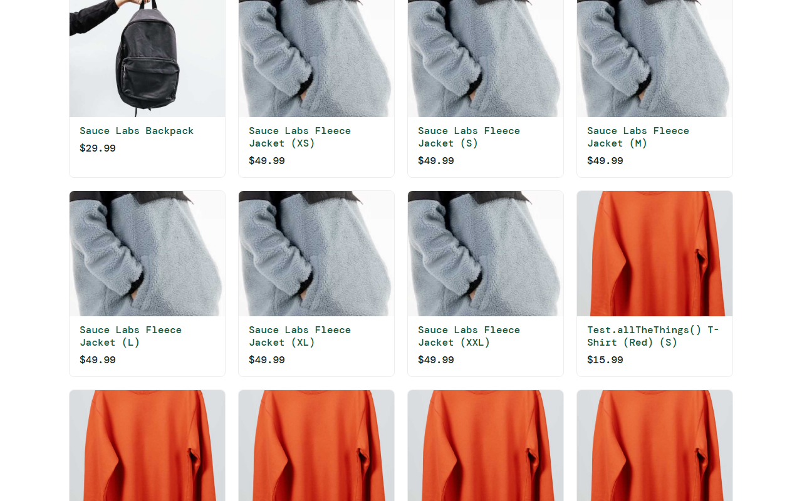

### BUG-08

**Todas las imágenes de los productos son la misma**

| Categoría | Tipo | Severidad | Usuario | Origen | Lo encontró | Issue |
|-----------|------|-----------|---------|--------|-------------|-------|
| **Visual** | Visual | Major | `problem_user` | Usuario de prueba (intencional) | Ambos | No aplica (defecto intencional) |

**Requisito:** RF-PRO-01 · RNF-VIS-02 · **Test:** `USR-01`

**Pasos para reproducir**
1. Login con `problem_user`
2. Observar el listado

**Resultado esperado:** Cada producto muestra su propia imagen.

**Resultado observado:** 1 imagen distinta en 6 productos.

**Impacto:** El comprador no puede identificar visualmente los productos.

**Evidencia**

### BUG-09

**El orden por precio y Z–A no funciona**

| Categoría | Tipo | Severidad | Usuario | Origen | Lo encontró | Issue |
|-----------|------|-----------|---------|--------|-------------|-------|
| **No bloqueante** | Funcional | Major | `problem_user` | Usuario de prueba (intencional) | Ambos | No aplica (defecto intencional) |

**Requisito:** RF-PRO-03 · **Test:** `USR-03`

**Pasos para reproducir**
1. Login con `problem_user`
2. Elegir *Price (low to high)*

**Resultado esperado:** Precios en orden ascendente.

**Resultado observado:** Tras ordenar, los precios quedan: $29.99, $9.99, $15.99, $49.99, $7.99, $15.99 (sin cambios). Solo *A to Z* funciona.

**Impacto:** El comprador no puede ordenar el catálogo.

**Evidencia**

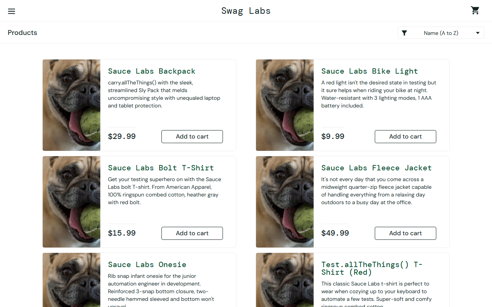

### BUG-10

**Solo 3 de 6 botones "Add to cart" funcionan**

| Categoría | Tipo | Severidad | Usuario | Origen | Lo encontró | Issue |
|-----------|------|-----------|---------|--------|-------------|-------|
| **No bloqueante** | Funcional | Major | `problem_user` | Usuario de prueba (intencional) | Ambos | No aplica (defecto intencional) |

**Requisito:** RF-PRO-05, RF-PRO-06 · **Test:** `USR-02`

**Pasos para reproducir**
1. Login con `problem_user`
2. Pulsar *Add to cart* en los 6 productos

**Resultado esperado:** Contador en 6 y los 6 botones en *Remove*.

**Resultado observado:** Contador en 3; botones: Remove, Remove, Add to cart, Add to cart, Remove, Add to cart.

**Impacto:** Hay 3 productos que no se pueden agregar. Se puede comprar el resto, por eso no es bloqueante.

**Evidencia**

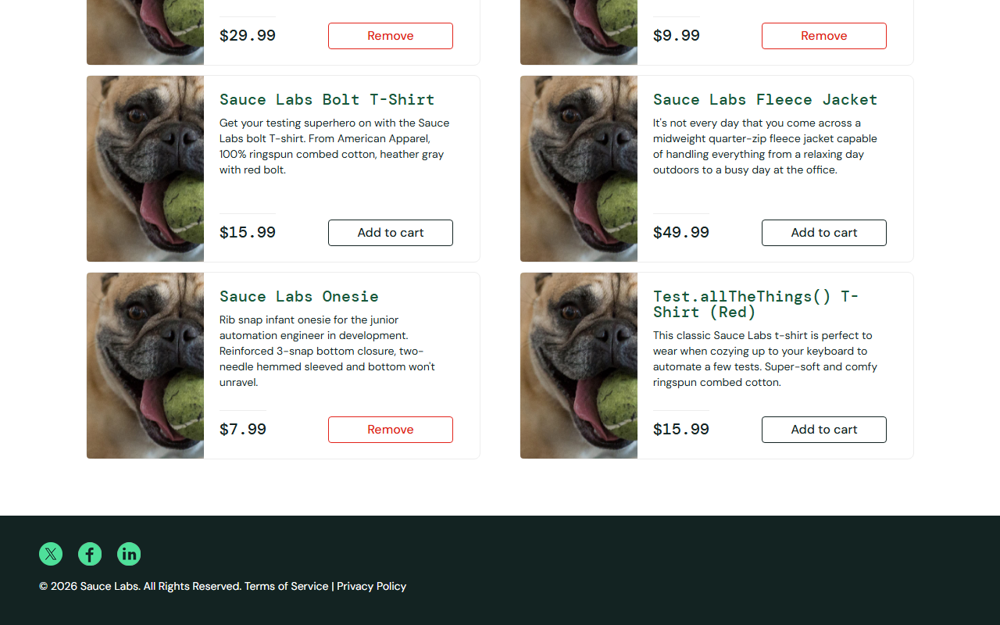

### BUG-11

**El apellido se escribe en el campo del nombre y no se puede completar el checkout**

| Categoría | Tipo | Severidad | Usuario | Origen | Lo encontró | Issue |
|-----------|------|-----------|---------|--------|-------------|-------|
| **Bloqueante** | Funcional | Blocker | `problem_user` | Usuario de prueba (intencional) | Agente | No aplica (defecto intencional) |

**Requisito:** RF-CHK-01, RF-CHK-05 · **Test:** `USR-04`, `MAT-problem_user` (C09, C10)

**Pasos para reproducir**
1. Login con `problem_user`, agregar un producto
2. Carrito → Checkout
3. Escribir nombre `Ana`, apellido `Pérez`, postal `1000`
4. Pulsar **Continue**

**Resultado esperado:** Cada dato en su campo y avance al resumen.

**Resultado observado:** Campos tras escribir: nombre=`Pérez`, apellido=`(vacío)`. Al continuar: `Error: Last Name is required` y la URL sigue en `checkout-step-one`.

**Impacto:** Impide completar la compra con este usuario.

**Evidencia**

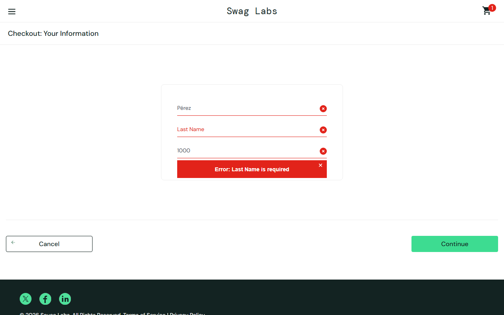

### BUG-12

**Al ordenar aparece un aviso de error de Backtrace y no ordena**

| Categoría | Tipo | Severidad | Usuario | Origen | Lo encontró | Issue |
|-----------|------|-----------|---------|--------|-------------|-------|
| **No bloqueante** | Funcional | Major | `error_user` | Usuario de prueba (intencional) | Ambos | No aplica (defecto intencional) |

**Requisito:** RF-PRO-03 · **Test:** `USR-03b`

**Pasos para reproducir**
1. Login con `error_user`
2. Elegir *Name (Z to A)*

**Resultado esperado:** Lista en orden Z–A y sin avisos de error.

**Resultado observado:** Aparece el aviso «Sorting is broken! This error has been reported to Backtrace.» y el orden queda A–Z.

**Impacto:** El comprador no puede ordenar y recibe un aviso técnico.

**Evidencia**

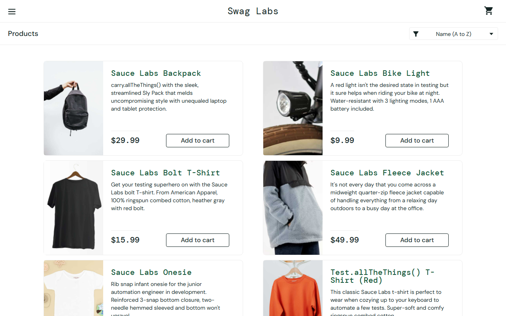

### BUG-13

**Solo algunos botones agregan y ninguno quita desde el listado**

| Categoría | Tipo | Severidad | Usuario | Origen | Lo encontró | Issue |
|-----------|------|-----------|---------|--------|-------------|-------|
| **No bloqueante** | Funcional | Major | `error_user` | Usuario de prueba (intencional) | Ambos | No aplica (defecto intencional) |

**Requisito:** RF-PRO-05, RF-PRO-06 · **Test:** `USR-02b`, `USR-02c`

**Pasos para reproducir**
1. Login con `error_user`
2. Pulsar *Add to cart* en los 6 productos
3. Pulsar *Remove* en los agregados

**Resultado esperado:** Contador en 6; *Remove* quita desde el listado.

**Resultado observado:** Contador en 3; botones: Remove, Remove, Add to cart, Add to cart, Remove, Add to cart. El *Remove* del listado no quita; sí se puede quitar desde el carrito (según la persona que prueba).

**Impacto:** Faltan productos al agregar y no se pueden quitar desde el listado.

**Evidencia**

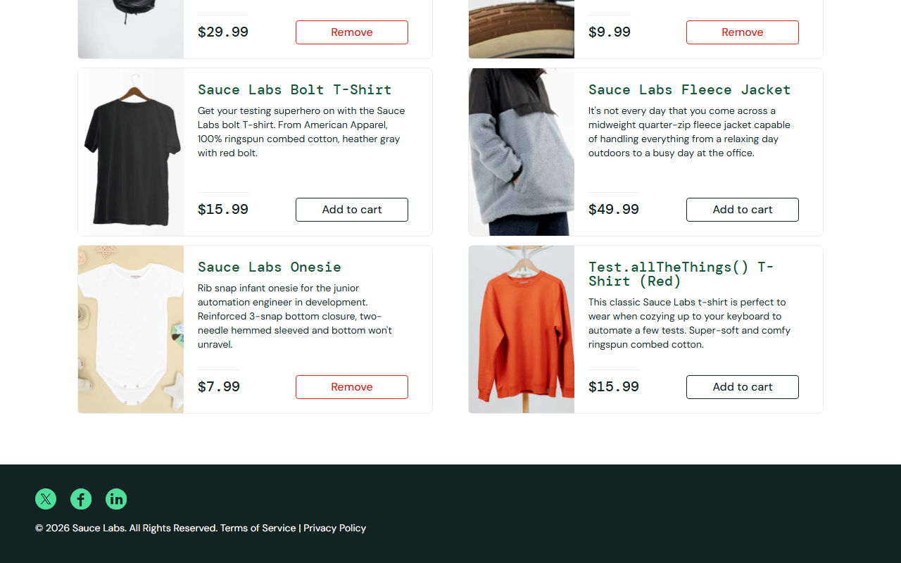

### BUG-14

**No se puede finalizar la compra (Finish no completa)**

| Categoría | Tipo | Severidad | Usuario | Origen | Lo encontró | Issue |
|-----------|------|-----------|---------|--------|-------------|-------|
| **Bloqueante** | Funcional | Blocker | `error_user` | Usuario de prueba (intencional) | Agente | No aplica (defecto intencional) |

**Requisito:** RF-CHK-13 · **Test:** `USR-06`, `MAT-error_user` (C09, C10)

**Pasos para reproducir**
1. Login con `error_user`, agregar un producto
2. Carrito → Checkout
3. Escribir los tres datos y **Continue**
4. Pulsar **Finish**

**Resultado esperado:** Pantalla «Thank you for your order!».

**Resultado observado:** Tras **Finish** la URL sigue en `/checkout-step-two.html` (compra completada: False). Además el apellido queda vacío: nombre=`Ana`, apellido=`(vacío)`, postal=`1000`.

**Impacto:** Impide completar cualquier compra con este usuario.

**Evidencia**

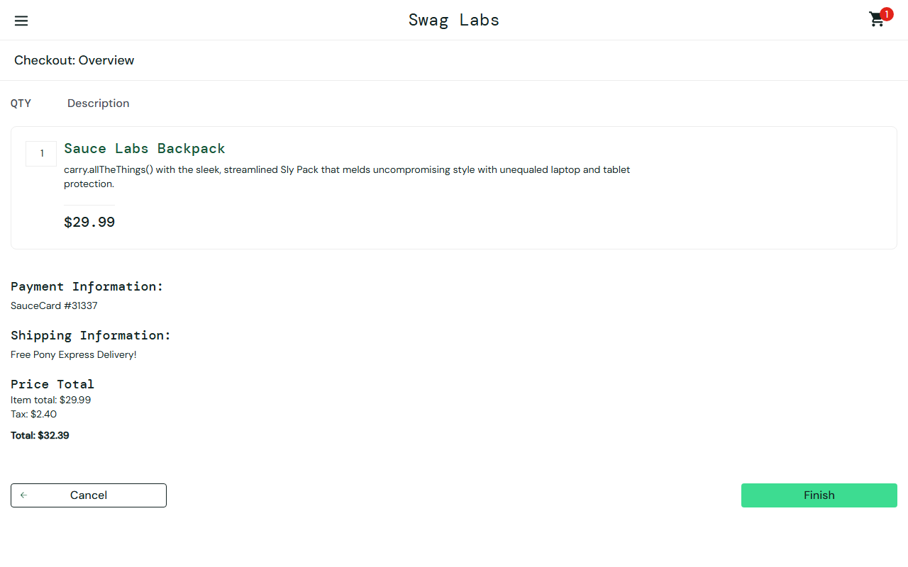

### BUG-15

**Login y carga del inventario tardan unos 5 segundos**

| Categoría | Tipo | Severidad | Usuario | Origen | Lo encontró | Issue |
|-----------|------|-----------|---------|--------|-------------|-------|
| **No bloqueante** | Rendimiento | Major | `performance_glitch_user` | Usuario de prueba (intencional) | Ambos | No aplica (defecto intencional) |

**Requisito:** Duda 11.4 (umbral 3 s de prueba) · **Test:** `USR-05`, `MAT-performance_glitch_user` (C11)

**Pasos para reproducir**
1. Login con `performance_glitch_user` midiendo hasta ver el inventario
2. Recargar `/inventory.html`

**Resultado esperado:** Carga en menos de 3 s (umbral de prueba; el documento no define uno).

**Resultado observado:** Login: 5174 ms (estándar 166 ms). Recarga del inventario: 5101 ms (estándar 307 ms). Abrir el menú: 35 ms (estándar 31 ms): **no** es lento.

**Impacto:** Espera larga al entrar; el resto de la navegación responde normal.

**Evidencia**

### BUG-16

**Ordenar por precio tarda unos 5 segundos**

| Categoría | Tipo | Severidad | Usuario | Origen | Lo encontró | Issue |
|-----------|------|-----------|---------|--------|-------------|-------|
| **No bloqueante** | Rendimiento | Minor | `performance_glitch_user` | Usuario de prueba (intencional) | Ambos | No aplica (defecto intencional) |

**Requisito:** Duda 11.4 · **Test:** `USR-05b`, `MAT-performance_glitch_user` (C12)

**Pasos para reproducir**
1. Login con `performance_glitch_user`
2. Elegir *Price (low to high)* y medir hasta ver el orden

**Resultado esperado:** Menos de 3 s.

**Resultado observado:** 5030 ms (estándar 32 ms).

**Impacto:** La interfaz parece congelada durante el orden.

**Evidencia**

### BUG-17

**Los precios mostrados son aleatorios y cambian en cada carga**

| Categoría | Tipo | Severidad | Usuario | Origen | Lo encontró | Issue |
|-----------|------|-----------|---------|--------|-------------|-------|
| **No bloqueante** | Contenido / funcional | Major | `visual_user` | Usuario de prueba (intencional) | Agente | No aplica (defecto intencional) |

**Requisito:** RF-PRO-01, RF-PRO-03 · **Test:** `USR-07a`, `MAT-visual_user` (C04, C06)

**Pasos para reproducir**
1. Login con `visual_user` y anotar los precios
2. Recargar la página y comparar
3. Ordenar por *Price (low to high)*

**Resultado esperado:** Los precios del catálogo (29.99, 9.99, 15.99, 49.99, 7.99, 15.99) fijos y ordenables.

**Resultado observado:** Carga 1: $28.99, $35.27, $45.9, $26.58, $55.15, $45.63. Carga 2: $14.79, $36.39, $75.91, $69.92, $84.99, $19.27. Tras ordenar de menor a mayor: $37.56, $64.67, $85.66, $33.82, $29.59, $26.16 (desordenados).

**Impacto:** El comprador ve precios incorrectos e inestables; el orden por precio parece roto.

**Evidencia**

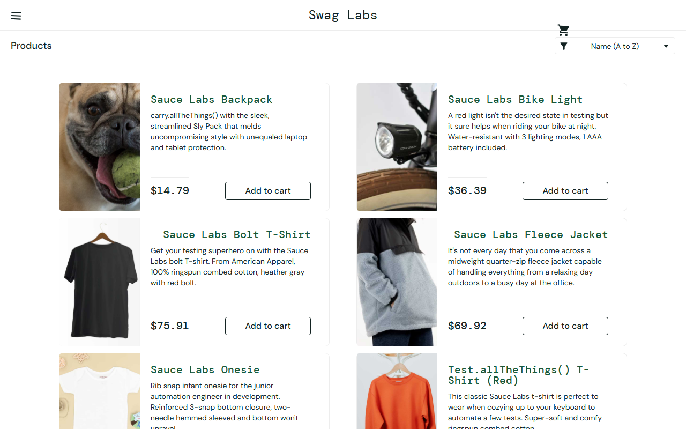

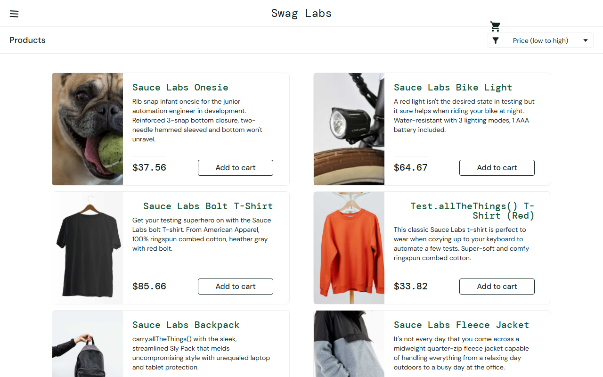

### BUG-18

**La imagen del primer producto no es la correcta**

| Categoría | Tipo | Severidad | Usuario | Origen | Lo encontró | Issue |
|-----------|------|-----------|---------|--------|-------------|-------|
| **Visual** | Visual | Minor | `visual_user` | Usuario de prueba (intencional) | Ambos | No aplica (defecto intencional) |

**Requisito:** RNF-VIS-02 · **Test:** `USR-07c`, `MAT-visual_user` (C16)

**Pasos para reproducir**
1. Login con `visual_user`
2. Observar el primer producto

**Resultado esperado:** La imagen de *Sauce Labs Backpack* (`sauce-backpack-…jpg`).

**Resultado observado:** Muestra `sl-404-Cq1a9k9X.jpg` (imagen sustituta de error).

**Impacto:** Imagen que no corresponde al producto.

**Evidencia**

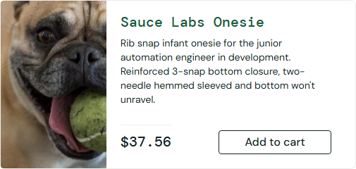

### BUG-19

**El ícono del carrito está desplazado y se solapa con el selector de orden**

| Categoría | Tipo | Severidad | Usuario | Origen | Lo encontró | Issue |
|-----------|------|-----------|---------|--------|-------------|-------|
| **Visual** | Visual | Minor | `visual_user` | Usuario de prueba (intencional) | Ambos | No aplica (defecto intencional) |

**Requisito:** RNF-VIS-01, RNF-VIS-07 · **Test:** `USR-07b`, `MAT-visual_user` (C13)

**Pasos para reproducir**
1. Login con `visual_user` a 1280×800
2. Observar el encabezado

**Resultado esperado:** Carrito en x=1220, y=10 (posición del usuario estándar).

**Resultado observado:** Carrito en x=1034, y=39 (alto 42 px); se solapa 11 px con el selector de orden.

**Impacto:** Elementos encimados y fuera de su lugar.

**Evidencia**

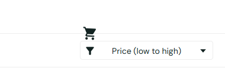

### BUG-20

**El botón Checkout del carrito aparece desplazado a la esquina superior**

| Categoría | Tipo | Severidad | Usuario | Origen | Lo encontró | Issue |
|-----------|------|-----------|---------|--------|-------------|-------|
| **Visual** | Visual | Minor | `visual_user` | Usuario de prueba (intencional) | Ambos | No aplica (defecto intencional) |

**Requisito:** RNF-VIS-07 · **Test:** `USR-07d`, `MAT-visual_user` (C14)

**Pasos para reproducir**
1. Login con `visual_user`
2. Abrir el carrito a 1280×800

**Resultado esperado:** Botón Checkout en x=1045, y=218 (usuario estándar).

**Resultado observado:** Botón en x=1060, y=0, pegado al borde superior. Sigue siendo pulsable.

**Impacto:** Diseño roto en el carrito; no impide comprar.

**Evidencia**

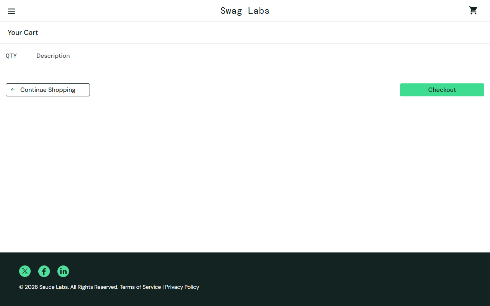

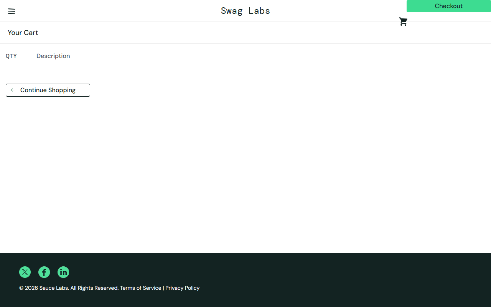

### BUG-21

**El ícono del menú está inclinado**

| Categoría | Tipo | Severidad | Usuario | Origen | Lo encontró | Issue |
|-----------|------|-----------|---------|--------|-------------|-------|
| **Visual** | Visual | Minor | `visual_user` | Usuario de prueba (intencional) | Persona | No aplica (defecto intencional) |

**Requisito:** RNF-VIS-07 · **Test:** `USR-07e`, `MAT-visual_user` (C15)

**Pasos para reproducir**
1. Login con `visual_user`
2. Ampliar el ícono ☰ del encabezado

**Resultado esperado:** Íconos sin rotación (`transform: none`) y de 20×20 px.

**Resultado observado:** La imagen `bm-icon visual_failure` tiene `matrix(0.99863, 0.052336, -0.052336, 0.99863, 0, 0)` (rotación de unos 3°) y mide 21 px de ancho. La clase delata el defecto.

**Impacto:** Detalle visual que rompe la consistencia.

**Evidencia**

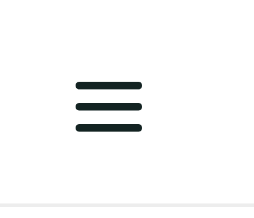

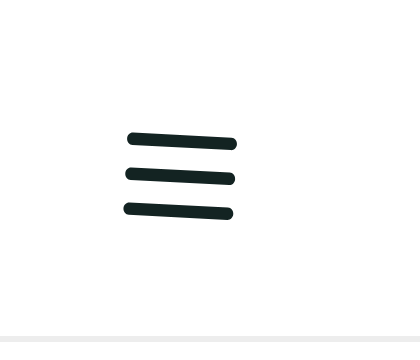

## 5. No son bugs (se anotan como observaciones)

| Observación | Por qué no es un bug | Dónde |
|-------------|----------------------|-------|
| `locked_out_user` no puede iniciar sesión | Es el comportamiento esperado (RF-LOG-04) | `LOG-04`, `MAT-locked_out_user` |
| Las direcciones directas (`/inventory.html`) responden HTTP 404 y luego cargan | Característica del alojamiento en GitHub Pages; la aplicación funciona | `VIS-24` |
| Falta un botón de "continuar" o "ir al carrito" en el catálogo | Decisión de diseño: el carrito se abre con el ícono. Sugerencia de mejora | Evaluación, hallazgo 15 |
| No hay cantidades ni aviso de "última unidad" | El documento lo define así (RN-02). Sería un requisito nuevo | Evaluación, hallazgo 16 |
| Las 3 rayitas del menú inclinadas | Es un defecto intencional de `visual_user` (BUG-21), no del producto | `USR-07e` |

## 6. Cómo mantener la matriz

1. Regenerar las evidencias cuando cambie el sitio: `node automatizacion/herramientas/capturar-evidencias.mjs`.
2. Cada bug nuevo lleva ID `BUG-NN`, categoría, severidad, origen, pasos, esperado, observado, impacto y evidencia.
3. Los bugs del producto se reportan como issue en GitHub (plantilla `bug.yml`); los de usuarios de prueba solo se documentan aquí.
4. Los defectos conocidos se dejan en el código como fallos esperados (`test.fail`): si el sitio los corrige, el test avisa y el bug pasa a *Resuelto*.
